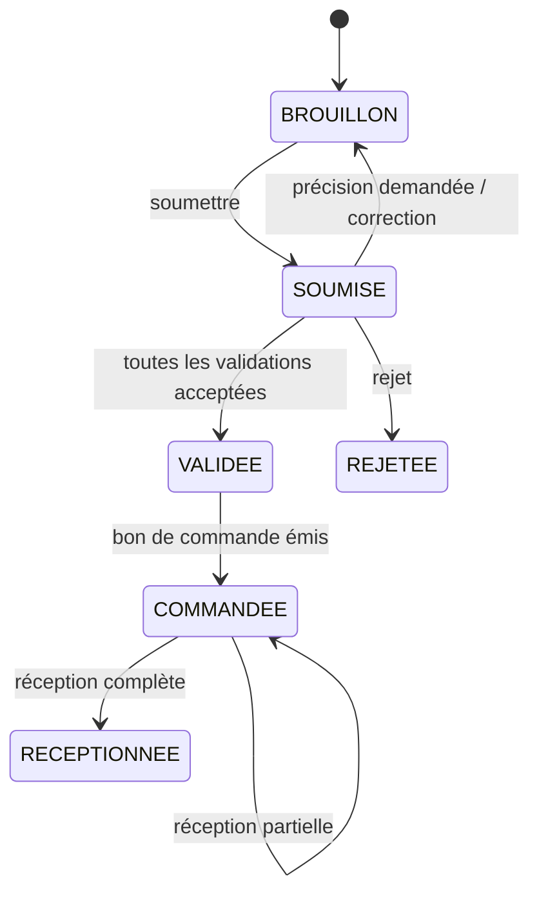
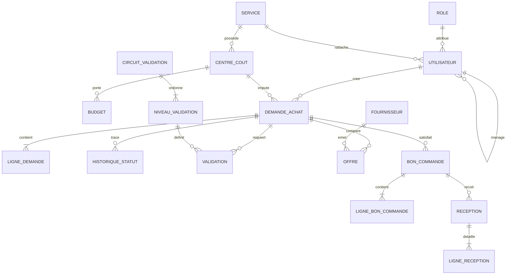
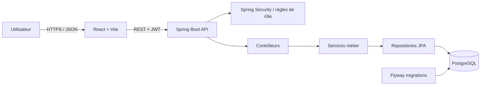

# Phase 1 — Analyse et conception

Cette phase couvre le premier mois du planning : cadrage fonctionnel, modèle de données, architecture et maquettes de navigation. Elle s’appuie sur le cahier des charges et sur le schéma PostgreSQL versionné dans `backend/src/main/resources/db/migration/V1__initial_schema.sql`.

## 1. Objectif et périmètre

La plateforme centralise le cycle d’achat : demande interne, validations, consultation des fournisseurs, commande, réception et suivi budgétaire. Chaque décision doit être rattachée à un utilisateur, datée et consultable dans l’historique.

Le périmètre fonctionnel comprend :

- la création et le suivi des demandes d’achat avec leurs lignes, leur centre de coût et leur justification ;
- un circuit de validation configurable par service, ordre, rôle et seuil de montant ;
- le référentiel des fournisseurs et catégories, ainsi que les offres liées aux demandes ;
- la création des bons de commande depuis une offre et l’enregistrement des réceptions partielles ou totales ;
- les budgets annuels par centre de coût et les alertes au seuil configuré ;
- l’administration des utilisateurs, rôles, services et circuits de validation ;
- les indicateurs et exports de suivi prévus pour une phase ultérieure.

## 2. Acteurs et droits attendus

| Acteur | Besoins principaux | Droits de référence |
| --- | --- | --- |
| Demandeur | Créer un brouillon, soumettre une demande, suivre ses demandes et commandes | Lire et modifier ses brouillons ; consulter ses dossiers |
| Manager | Examiner les demandes de son périmètre | Valider, rejeter ou demander une précision au niveau qui lui est attribué |
| Service achats | Comparer les offres et assurer le suivi fournisseur | Gérer fournisseurs/offres, générer les bons de commande et suivre leur réception |
| Administrateur | Administrer la plateforme et ses règles | Gérer utilisateurs, rôles, services, centres de coût, budgets et circuits |

Les autorisations doivent être appliquées côté API. Le filtrage des données doit également tenir compte du rôle et du périmètre utilisateur ; masquer un bouton dans l’interface ne constitue pas un contrôle d’accès.

## 3. Règles métier de départ

1. Une demande possède une référence unique, un demandeur, un centre de coût, un objet et au moins une ligne avant sa soumission.
2. Le montant estimé est calculé à partir des lignes (quantité × prix unitaire estimé). Les montants ne peuvent pas être négatifs et les quantités doivent être positives.
3. La soumission fige le contenu destiné à la validation et crée l’historique de changement de statut.
4. Les niveaux de validation sont parcourus dans l’ordre du circuit applicable. Une décision de rejet termine le parcours ; une demande de précision renvoie le dossier au demandeur.
5. Une offre est rattachée à une demande et à un fournisseur. Le choix d’une offre retenue précède la génération du bon de commande.
6. Une réception enregistre les quantités effectivement reçues par ligne ; le statut du bon de commande reflète la réception partielle ou complète.
7. Le budget engagé est calculé à partir des commandes prises en compte. Le seuil d’alerte est paramétrable par budget et ne remplace pas une règle explicite de blocage.
8. Les changements de statut et décisions conservent l’auteur, la date et, le cas échéant, un commentaire.

Les seuils exacts, la politique de dépassement budgétaire, le nombre minimal d’offres et les délais de validation sont des paramètres à confirmer avec le métier avant leur mise en production.

## 4. Cycle de vie proposé



Les états et événements enregistrés doivent rester cohérents avec les énumérations de la migration. Une précision demandée est une décision de validation ; elle n’est pas un statut de demande distinct dans le schéma actuel.

## 5. Modèle de données

Le schéma initial comporte 20 tables regroupées par domaine :

| Domaine | Tables | Rôle |
| --- | --- | --- |
| Identités et organisation | `role`, `service`, `utilisateur` | Accès, rattachement hiérarchique et organisation |
| Budget | `centre_cout`, `budget`, `alerte_budget` | Enveloppes annuelles, engagements et alertes |
| Catalogue et fournisseurs | `categorie`, `fournisseur`, `fournisseur_categorie` | Classement et répertoire fournisseur |
| Demandes | `demande_achat`, `ligne_demande`, `historique_statut` | En-tête, lignes et traçabilité |
| Validation | `circuit_validation`, `niveau_validation`, `validation` | Étapes ordonnées et décisions par demande |
| Achats et réception | `offre`, `bon_commande`, `ligne_bon_commande`, `reception`, `ligne_reception` | Comparaison, émission et réception des commandes |

Relations structurantes :



Les contraintes SQL imposent notamment l’unicité des références de demandes et commandes, l’unicité d’une offre par couple demande/fournisseur, l’unicité d’une validation par niveau et demande, ainsi que des montants non négatifs et des quantités positives.

## 6. Architecture cible



- **Interface** : React, navigation par rôle, appels REST centralisés et jeton JWT envoyé dans l’en-tête `Authorization`.
- **API** : Spring Boot en couches contrôleur, service et repository ; validation des entrées et gestion cohérente des erreurs HTTP.
- **Sécurité** : authentification sans session, mots de passe hachés, contrôle d’accès par rôle et contrôle du périmètre des données.
- **Persistance** : PostgreSQL ; migrations Flyway comme source de vérité du schéma. `ddl-auto` reste désactivé pour éviter les modifications de schéma implicites.
- **Documentation API** : OpenAPI/Swagger pour rendre les contrats REST consultables pendant le développement.

## 7. Maquettes fonctionnelles

### Navigation générale

```text
+----------------------------------------------------------------+
| e-Procurement                         Recherche   Profil  Sortir |
+----------------------+-----------------------------------------+
| Tableau de bord      | Titre de la page                        |
| Mes demandes         |                                         |
| À valider            | Contenu, filtres et actions selon rôle  |
| Commandes            |                                         |
| Fournisseurs         |                                         |
| Budgets              |                                         |
| Administration       |                                         |
+----------------------+-----------------------------------------+
```

Les entrées de navigation sont filtrées selon les droits, tandis que l’API demeure l’autorité d’accès.

### Tableau de bord demandeur

```text
Mes demandes                                  [+ Nouvelle demande]
[Brouillons 2] [En validation 3] [Commandées 1]
Filtrer : [Statut v] [Période v] [Rechercher référence...]
Référence | Objet             | Montant | Statut     | Mis à jour
DA-...    | Matériel bureau   |  ...    | En attente | ...
```

### Création d’une demande

```text
Nouvelle demande
Objet [________________________________________]
Centre de coût [_______________________________ v]
Justification [________________________________]
Lignes : Type | Désignation | Catégorie | Qté | Prix estimé | Total
         [____|____________|___________|_____|_____________|_____]
[Ajouter une ligne]                     Total estimé : ...
[Enregistrer le brouillon] [Soumettre]
```

### File de validation

```text
Demandes à traiter
Filtres : [Service v] [Montant v] [Demandeur v] [Statut v]
Référence | Demandeur | Objet | Montant | Niveau | Action
DA-...    | ...       | ...   | ...     | 1 / 2  | [Ouvrir]

Détail ouvert : lignes, justification, budget disponible, historique
Commentaire [____________________________________________]
[Demander une précision] [Rejeter] [Valider]
```

Les vues fournisseur, commande/réception, budget et administration suivent le même patron : liste filtrable, détail lisible, actions permises par le rôle et confirmation des opérations qui changent l’état d’un dossier.

## 8. Contrats et critères d’acceptation de conception

- Chaque ressource métier expose des identifiants stables et des DTO dédiés ; les entités JPA ne sont pas sérialisées directement pour les opérations sensibles.
- Les erreurs de validation indiquent le champ concerné ; les erreurs d’authentification et d’autorisation retournent respectivement `401` et `403`.
- Les listes sont filtrables et paginables avant leur usage à grande échelle.
- Les écrans principaux sont utilisables au clavier et adaptables aux largeurs mobile et bureau.
- Une demande, ses décisions, le bon de commande et les réceptions peuvent être reliés sans perte de traçabilité.
- Le montant affiché est recalculé côté serveur à partir des lignes ; le client ne peut pas imposer un total différent.

## 9. Livrables et suite

La phase 1 livre le cadrage, les règles métier initiales, le modèle relationnel, l’architecture et les maquettes ci-dessus. Le schéma physique associé est la migration Flyway initiale. La phase suivante peut démarrer sur les fondations techniques, l’authentification, le catalogue et le parcours demandeur/validation, en traitant les questions métier listées plus haut comme paramètres à confirmer.
